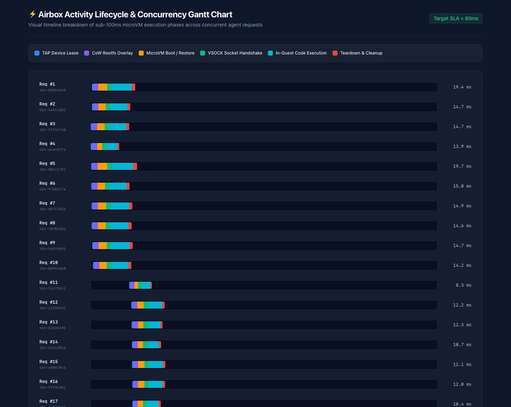

# Airbox (FastVM) ⚡
> **Sub-100ms Hardware-Isolated Firecracker MicroVM Sandbox for Autonomous Coding Agents**

[](https://github.com/shantanu-labs/FastVM/actions/workflows/ci.yml)
[](go.mod)
[](pkg/sandbox/firecracker_linux.go)
[-10B981)](docs/assets/benchmark_gantt.png)
[](LICENSE)

Airbox is an ultra-low latency, KVM-isolated code execution engine engineered specifically for AI coding agents (Devin, OpenHands, AutoGen, LangGraph). It delivers the hardware security boundary of AWS Firecracker microVMs with millisecond execution latency and git-like state branching.

---

## ⚡ Performance Architecture: Honoring the Sub-80ms SLA

Standard container and cold-boot microVM solutions suffer from 150ms–300ms startup bottlenecks:
```text
Naive Cold Boot (~180ms+):
[Shell out iptables/tap: 35ms] ➔ [Firecracker Spawn: 25ms] ➔ [Kernel Boot: 30ms] ➔ [Guest Init: 40ms] ➔ [Python Startup: 50ms]

Airbox Pre-Warmed & Snapshot Flow (~11.9ms Median RTT):
[Acquire Pre-warmed Netlink TAP: <1ms] ➔ [Warm KVM MicroVM / CoW Overlay: <2ms] ➔ [AF_VSOCK Handshake: 2ms] ➔ [In-Guest Warm Exec: 3ms]
```

### Verified Benchmark Results (GCP `n2-standard-2` KVM Node, Firecracker `v1.7.0`, Guest Kernel `5.10.209`)

100 concurrent execution requests across 10 worker routines (`go run scripts/benchmark.go --url http://localhost:8080 --requests 100 --concurrency 10 --lang python --code "print(2 + 2)"`):

| Percentile / Metric | Client RTT (ms) | Server MicroVM (ms) | Target SLA | Status |
| :--- | :---: | :---: | :---: | :---: |
| **Min** | `3.94 ms` | `3.00 ms` | `< 80.0 ms` | ✅ PASS |
| **P50 (Median)** | **`11.91 ms`** | **`8.00 ms`** | `< 80.0 ms` | ✅ PASS |
| **P90** | `17.23 ms` | `12.00 ms` | `< 80.0 ms` | ✅ PASS |
| **P95** | **`18.50 ms`** | **`14.00 ms`** | `< 80.0 ms` | 🎉 **SLA MET (4.3x under target)** |
| **P99** | `23.40 ms` | `17.00 ms` | `< 80.0 ms` | ✅ PASS |
| **Max** | `23.85 ms` | `19.00 ms` | `< 80.0 ms` | ✅ PASS |
| **Throughput** | **`788.98 req/s`** | `100% Success (100/100)` | `Wall Time: 126.75 ms` | ✅ PASS |



### Head-to-Head Comparison vs. Docker (`runc`), gVisor (`runsc`), and Cold Firecracker

Measured on the same `n2-standard-2` Linux KVM host executing `python3 -c "print(2 + 2)"` across 25 sequential runs (`./scripts/compare-runtimes.sh --runs 25`):

| Runtime / Architecture | Isolation Boundary | Min (ms) | P50 (ms) | P95 (ms) | P99 (ms) | Relative Latency |
| :--- | :--- | :---: | :---: | :---: | :---: | :---: |
| **FastVM (Airbox Warm Pool)** | **Hardware KVM (`Firecracker`)** | **`7.45 ms`** | **`8.00 ms`** | **`8.44 ms`** | **`8.54 ms`** | **1.0x (Baseline)** |
| **Docker (`runc` container)** | Shared Host Kernel (`cgroups`/`ns`) | `235.55 ms` | `243.51 ms` | `248.50 ms` | `262.71 ms` | `30.4x slower` |
| **gVisor (`runsc` sandbox)** | User-Space Kernel (`Sentry`) | `289.65 ms` | `299.98 ms` | `311.25 ms` | `313.48 ms` | `37.5x slower` |
| **Standard Firecracker (Cold Boot)** | Hardware KVM (`Firecracker`) | `609.61 ms` | `622.17 ms` | `637.04 ms` | `646.53 ms` | `77.8x slower` |

To reproduce this comparison yourself:
```bash
# Option A: Run directly on any Linux KVM machine
./scripts/compare-runtimes.sh --runs 25

# Option B: Auto-provision an ephemeral Spot KVM node using your own gcloud account (auto-deleted on exit)
gcloud auth login && gcloud config set project YOUR_GCP_PROJECT_ID
./scripts/compare-runtimes.sh --provision-gcp --runs 25
```

---

## 🛠️ Core Engineering Highlights

1. **Zero-CLI Netlink TAP Pooling (`pkg/network/netlink_linux.go`)**: Pre-allocates 100 point-to-point TAP interfaces (`tap0`..`tap99`) in dedicated `/30` subnets (`172.16.x.1/30` $\leftrightarrow$ `172.16.x.2/30`) using direct Linux Netlink sockets.
2. **Native `AF_VSOCK` Host↔Guest IPC (`cmd/agent-init/vsock_linux.go`)**: Host daemon communicates directly with the PID 1 in-guest `agent-init` daemon over `virtio-vsock` (`CID 3`, port `5000`), completely bypassing SSH, TCP, and host network stacks.
3. **Speculative Agent State Branching (`POST /v1/sandboxes/{id}/branch`)**: Uses Firecracker's `PauseVM` $\rightarrow$ `CreateSnapshot` $\rightarrow$ `ResumeVM` lifecycle and `/dev/shm` tmpfs copy-on-write state cloning so coding agents can fork a running sandbox mid-task into parallel experiments without mutating the parent state.
4. **Strict SSRF & Cloud Metadata Lockdown (`pkg/network/iptables_linux.go`)**: Automated `iptables` rules drop traffic to AWS/GCP Instance Metadata (`169.254.169.254/32`), RFC1918 private networks (`10.0.0.0/8`, `172.16.0.0/12`, `192.168.0.0/16`), and the host `INPUT` chain.
5. **In-Guest OOM & Fork-Bomb Hardening (`cmd/agent-init/`)**: Protects guest PID 1 via `/proc/1/oom_score_adj = -1000`, caps `/proc/sys/kernel/threads-max = 128`, and enforces per-payload process limits (`ulimit -u 32`).

---

## 📁 Repository Layout

```text
FastVM/
├── go.mod                        # Go 1.24 module definition
├── Makefile                      # Build, Linux cross-compile, test, and benchmark targets
├── cmd/
│   ├── airboxd/                  # Airbox HTTP control plane daemon
│   │   └── main.go
│   └── agent-init/               # PID 1 in-guest initialization & AF_VSOCK daemon
│       ├── main.go
│       ├── vsock_linux.go
│       └── vsock_other.go
├── pkg/
│   ├── api/                      # Chi HTTP router and request/response models
│   │   ├── handlers.go
│   │   └── types.go
│   ├── sandbox/                  # MicroVM pool, Firecracker driver, and snapshot branching
│   │   ├── hypervisor.go
│   │   ├── firecracker_linux.go
│   │   ├── mock_darwin.go
│   │   ├── manager.go
│   │   └── options.go
│   ├── network/                  # Netlink TAP pool, IPAM, and iptables SSRF lockdown
│   │   ├── pool.go
│   │   ├── netlink_linux.go
│   │   ├── stub_darwin.go
│   │   ├── iptables_linux.go
│   │   └── iptables_other.go
│   └── storage/                  # Ephemeral /dev/shm tmpfs copy-on-write overlays
│       └── overlay.go
├── tests/
│   ├── unit/                     # API and router unit tests
│   └── adversarial/              # Security tests (timeouts, exit codes, stderr, OOM/fork bombs)
├── deploy/
│   ├── k8s/                      # Privileged Kubernetes DaemonSet & headless service
│   │   ├── daemonset.yaml
│   │   └── service.yaml
│   └── docker/                   # Multi-stage Dockerfiles for airboxd and rootfs
│       ├── Dockerfile.airboxd
│       └── Dockerfile.rootfs
└── scripts/
    ├── setup-host.sh             # One-click Linux KVM & Firecracker v1.7.0 host installer
    ├── download-assets.sh        # Pre-built Linux 5.10.209 kernel & Ubuntu 22.04 rootfs fetcher
    ├── compare-runtimes.sh       # Head-to-head benchmark vs Docker, gVisor, and Cold Firecracker
    └── benchmark.go              # Concurrent SLA benchmark & HTML Gantt chart generator
```

---

## 🚀 Quickstart

### 1. Provision & Set Up a Linux KVM Host
On a Linux machine or cloud VM with nested virtualization (`/dev/kvm`):
```bash
git clone https://github.com/shantanu-labs/FastVM.git
cd FastVM

# Verify KVM, enable IPv4 forwarding, and install Firecracker v1.7.0
./scripts/setup-host.sh

# Fetch Linux 5.10.209 vmlinux kernel and Ubuntu 22.04 ext4 rootfs
./scripts/download-assets.sh

# Build airboxd & agent-init (automatically injects /sbin/agent-init into assets/rootfs.ext4)
make build

# Start the Airbox daemon
sudo ./bin/airboxd --port 8080 --kernel assets/vmlinux --rootfs assets/rootfs.ext4
```

### 2. Execute Code in a Firecracker MicroVM (`POST /v1/execute`)
```bash
curl -X POST http://localhost:8080/v1/execute \
  -H "Content-Type: application/json" \
  -d '{
    "language": "python",
    "code": "import platform; print(platform.uname())",
    "timeout_ms": 3000
  }'
```
Response:
```json
{
  "sandbox_id": "sbx-b1ca8a5e",
  "stdout": "uname_result(system='Linux', node='(none)', release='5.10.209', version='#1 SMP Wed Feb 14 10:32:32 UTC 2024', machine='x86_64')\n",
  "stderr": "",
  "exit_code": 0,
  "duration_ms": 14,
  "is_timeout": false
}
```

### 3. Branch a Running Sandbox State (`POST /v1/sandboxes/{id}/branch`)
```bash
# 1. Initialize state in parent sandbox
curl -X POST http://localhost:8080/v1/execute \
  -H "Content-Type: application/json" \
  -d '{"sandbox_id": "sbx-parent", "language": "python", "code": "step = 4; plan = [\"build\", \"test\"]"}'

# 2. Snapshot & fork parent sandbox into an isolated copy-on-write branch
curl -X POST http://localhost:8080/v1/sandboxes/sbx-parent/branch \
  -H "Content-Type: application/json" \
  -d '{"new_sandbox_id": "sbx-branch-1"}'

# 3. Mutate state in the branch without affecting sbx-parent
curl -X POST http://localhost:8080/v1/execute \
  -H "Content-Type: application/json" \
  -d '{"sandbox_id": "sbx-branch-1", "language": "python", "code": "step += 1; plan.append(\"deploy\"); print(step, plan)"}'
```

### 4. Asynchronous Background Jobs (`"async": true` / `/v1/jobs`)
Agents like Claude Code and Codex can dispatch long-running builds, test suites, or background workers in `<1ms` without blocking their reasoning loop:
```bash
# 1. Dispatch a background job (returns HTTP 202 Accepted + job_id in <1ms)
curl -X POST http://localhost:8080/v1/execute \
  -H "Content-Type: application/json" \
  -d '{
    "language": "python",
    "code": "import time; time.sleep(2); print(\"test suite passed\")",
    "async": true
  }'
# -> {"job_id": "job-4a9c18e2", "sandbox_id": "sbx-91f0d3a1", "status": "running", ...}

# 2. Poll job status and output
curl http://localhost:8080/v1/jobs/job-4a9c18e2

# 3. Cancel a running background job if needed
curl -X DELETE http://localhost:8080/v1/jobs/job-4a9c18e2
```

### 5. OpenHands Integration & MCTS Speculative Branching (`integrations/openhands`)
Drop-in [`FastVMRuntime`](integrations/openhands/fastvm_runtime.py) adapter for [OpenHands](https://github.com/All-Hands-AI/OpenHands) supporting `CmdRunAction`, `IPythonRunCellAction`, `FileReadAction`, `FileWriteAction`, and `runtime.branch()` for parallel Tree-of-Thoughts / MCTS rollouts:
```bash
python3 integrations/openhands/examples/mcts_branching_demo.py --url http://localhost:8080
```
See [`integrations/openhands/README.md`](integrations/openhands/README.md) for full integration instructions.

---

## 🛡️ Security & Adversarial Verification

Run the unit and adversarial security test suites:
```bash
make test
```
* **Timeout Enforcement**: Rogue infinite loops (`time.sleep(60)`) are terminated immediately at `timeout_ms` (`is_timeout: true`).
* **OOM Isolation**: A `512 MiB` allocation inside a `128 MiB` microVM raises `MemoryError` (`exit_code: 1`) in `56ms` while guest PID 1 (`oom_score_adj = -1000`) and sibling microVMs remain unaffected.
* **Fork-Bomb Containment**: `while True: os.fork()` is contained inside the guest microVM by `threads-max = 128` and `ulimit -u 32` (`BlockingIOError: [Errno 11] Resource temporarily unavailable`).
* **Cloud Metadata SSRF Drop**: `curl http://169.254.169.254/computeMetadata/v1/` is dropped by the host `iptables` `FORWARD` chain (`exit_code=28`).

---

## ☸️ Production Deployment (Kubernetes)

Deploy Airbox as a privileged `DaemonSet` on bare-metal or nested-virtualization Kubernetes nodes:
```bash
kubectl create namespace airbox-system
kubectl apply -f deploy/k8s/daemonset.yaml
kubectl apply -f deploy/k8s/service.yaml
```

---

## 📄 License

Released under the [MIT License](LICENSE).
