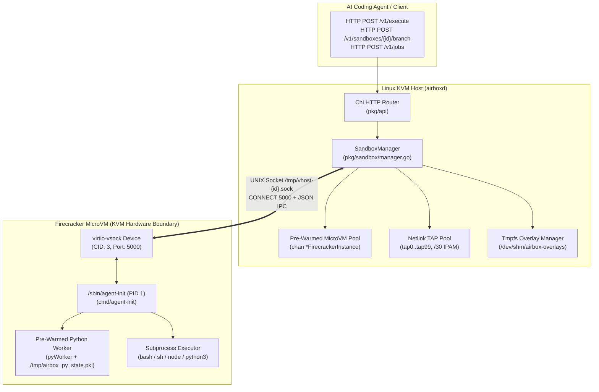
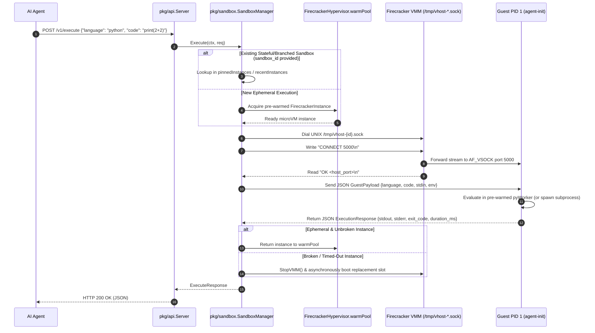

# System Architecture Overview

FastVM (Airbox) is engineered around a single core objective: **deliver hardware-level KVM isolation (via AWS Firecracker) at sub-80ms P95 latency** so AI coding agents can execute untrusted code, run tools, and branch state interactively without container-escape risks or cold-boot delays.

---

## 1. High-Level Architecture

FastVM separates responsibilities into two binaries compiled from the same Go repository:

1. **Host Control Plane (`cmd/airboxd`)**: Runs on the Linux KVM host. Manages the HTTP API, pre-warmed microVM pool, Netlink TAP network pool, `/dev/shm` rootfs overlays, and Firecracker VMM processes.
2. **In-Guest Init Daemon (`cmd/agent-init`)**: Injected into the guest `rootfs.ext4` as `/sbin/agent-init`. Runs as **PID 1** inside every Firecracker microVM, mounts essential pseudo-filesystems, listens on `AF_VSOCK` port `5000`, and maintains a pre-warmed Python 3 worker.

---

## 2. Why Standard MicroVMs Are Slow (And How FastVM Fixes It)

A naive cold-boot Firecracker workflow takes **180ms–600ms+** per execution because every request pays five sequential penalties:

| Bottleneck Stage | Naive Cold Boot | FastVM Design | FastVM Latency |
| :--- | :---: | :--- | :---: |
| **1. Network Setup** | Shell out to `ip tuntap` & `iptables` (`~35ms`) | Pre-allocated Netlink TAP pool (`tap0`..`tap99`) at startup | **`< 1 ms`** |
| **2. Rootfs Provisioning** | Full disk copy of `rootfs.ext4` (`~40ms+`) | Pre-mounted sparse/reflink overlay in `/dev/shm` (`tmpfs`) | **`< 1 ms`** |
| **3. VM & Kernel Boot** | Spawn `firecracker` + boot `vmlinux` (`~60ms`) | Acquire already-booted VM from `warmPool` channel | **`< 1 ms`** |
| **4. Host $\leftrightarrow$ Guest IPC** | Wait for guest `eth0` + SSH/HTTP server (`~40ms`) | Direct `AF_VSOCK` stream (`CID 3`, port `5000`) | **`~2 ms`** |
| **5. Language Runtime** | Cold start `python3` binary (`~25ms–50ms`) | Persistent in-guest `pyWorker` loop | **`~3 ms`** |
| **Total Server Latency** | **`180ms – 620ms+`** | **End-to-End Pre-Warmed Pipeline** | **`~8 ms` (P50)** |

---

## 3. Core Package Responsibilities

| Package / Path | Responsibility |
| :--- | :--- |
| `cmd/airboxd` | CLI flags, daemon lifecycle, graceful `SIGINT`/`SIGTERM` shutdown, wires `SandboxManager` to the HTTP server. |
| `cmd/agent-init` | Static Linux binary running as `PID 1` inside the guest microVM; mounts `/proc`, `/sys`, `/dev`, `/tmp`; runs the `AF_VSOCK` server and pre-warmed `pyWorker`. |
| `pkg/api` | `go-chi` HTTP router, middleware, and JSON request/response schemas (`/healthz`, `/v1/execute`, `/v1/jobs`, `/v1/sandboxes/{id}/branch`). |
| `pkg/sandbox` | Defines the `Hypervisor` and `Instance` interfaces, `SandboxManager` orchestration, `FirecrackerHypervisor` (Linux KVM), and `MockHypervisor` (macOS/CI fallback). |
| `pkg/network` | `NetworkPool` abstraction, direct Linux Netlink TAP creation (`NetlinkPool`), `/30` subnet IPAM calculator, and `iptables` SSRF/RFC1918 egress firewall rules. |
| `pkg/storage` | `OverlayManager` managing ephemeral per-sandbox `ext4` rootfs copies backed by `/dev/shm/airbox-overlays` (`tmpfs`). |

---

## 4. End-to-End Request Flow (`POST /v1/execute`)

---

## 5. Cross-Platform & Unprivileged Fallback Model

To ensure developers can build and run `make test` on **macOS (Darwin)** or in **unprivileged CI containers** without `/dev/kvm` or `CAP_NET_ADMIN`, FastVM uses Go build tags (`//go:build linux` vs `//go:build !linux`) and runtime capability checks:

* **Hypervisor Fallback**: On Linux with `/dev/kvm`, `NewHypervisor` uses `FirecrackerHypervisor`. If `/dev/kvm`, the `firecracker` binary, or the kernel image is absent (or on macOS), it transparently falls back to `MockHypervisor` (`pkg/sandbox/mock.go`), which mirrors the exact same `Instance` lifecycle, state pickling, and timeout semantics using isolated host subprocesses.
* **Network Pool Fallback**: On Linux with `CAP_NET_ADMIN`, `NewNetlinkPool` creates kernel `tap0`..`tapN` interfaces via Netlink. Without root privileges (or on macOS via `pkg/network/stub_darwin.go`), it falls back to an in-memory simulated TAP pool so IPAM and pool exhaustion logic can still be unit-tested.
