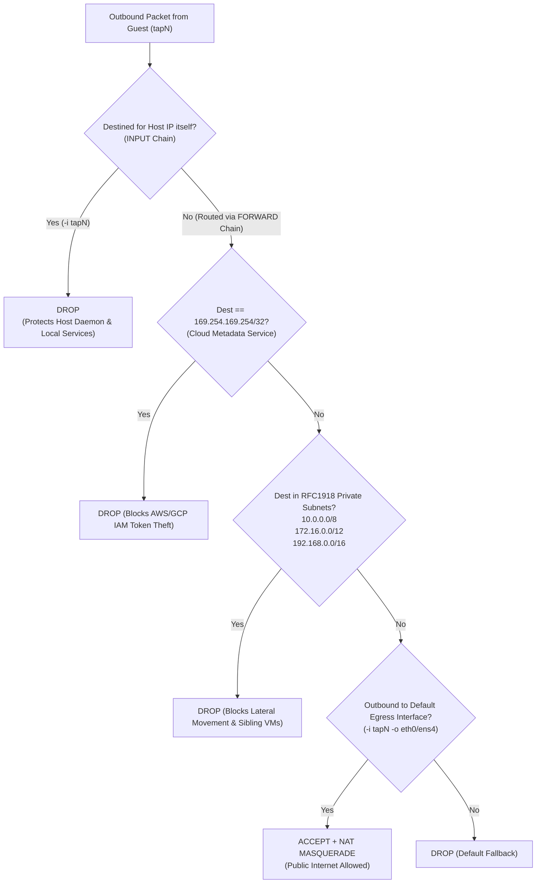

# Networking & Security Isolation

Executing code generated by LLMs requires strict defense-in-depth. FastVM combines **hardware virtualization (KVM)**, **network micro-segmentation (Netlink TAP + `iptables`)**, and **in-guest kernel resource limits** to prevent sandbox breakouts, Server-Side Request Forgery (SSRF), and Denial-of-Service (DoS) attacks.

---

## 1. Zero-CLI Netlink TAP Pool & `/30` IPAM (`pkg/network`)

Spawning `ip link add` via shell subprocesses for every microVM adds ~35ms of latency. Instead, `NewNetlinkPool` (`pkg/network/netlink_linux.go`) pre-allocates `tap0` through `tap99` at daemon startup using direct Linux Netlink sockets (`github.com/vishvananda/netlink`).

### Dedicated `/30` Subnet Allocation per MicroVM
Rather than bridging all microVMs onto a shared L2 broadcast domain (where a compromised guest could perform ARP spoofing or sniff traffic from sibling VMs), every TAP device is isolated in its own point-to-point **`/30` subnet**:

$$\text{Block Offset} = i \times 4$$

| TAP Index ($i$) | Interface Name | Host Gateway IP | Guest IP | Subnet Mask | Guest MAC Address |
| :---: | :---: | :---: | :---: | :---: | :---: |
| `0` | `tap0` | `172.16.0.1` | `172.16.0.2` | `/30` (`255.255.255.252`) | `AA:FC:00:00:00:00` |
| `1` | `tap1` | `172.16.0.5` | `172.16.0.6` | `/30` (`255.255.255.252`) | `AA:FC:00:00:00:01` |
| `2` | `tap2` | `172.16.0.9` | `172.16.0.10` | `/30` (`255.255.255.252`) | `AA:FC:00:00:00:02` |
| $i$ | `tap`$i$ | `172.16.`$\lfloor\frac{4i+1}{256}\rfloor$`.`$((4i+1) \bmod 256)$ | `HostIP + 1` | `/30` | `AA:FC:00:00:`$\text{hi}$`:`$\text{lo}$ |

### Guest Network Auto-Configuration
When Firecracker boots a microVM with a TAP device attached, it passes `airbox_ip=<GuestIP>/30 airbox_gw=<HostIP>` on the kernel command line (`/proc/cmdline`). `agent-init` parses `/proc/cmdline` (`cmd/agent-init/main.go`) and configures `eth0` and `/etc/resolv.conf` inside the guest.

---

## 2. Strict `iptables` Firewall & SSRF Lockdown (`pkg/network/iptables_linux.go`)

A major vulnerability in cloud-hosted code sandboxes is **Server-Side Request Forgery (SSRF)** against cloud provider metadata services (e.g., querying `http://169.254.169.254/computeMetadata/v1/` on GCP or AWS IMDS to steal IAM credentials) or lateral movement across internal VPC networks.

When a TAP device is attached to a microVM, `SetupFirewallRules` configures idempotent `iptables` rules (using `iptables -C` checks before applying):

### Summary of Applied `iptables` Rules
1. **Host Input Protection**:
   - `iptables -I INPUT -i <tapName> -j DROP` — Blocks the guest microVM from connecting to any port on the host machine itself (including `airboxd` on `:8080`, host SSH, or kubelet ports).
2. **Top-of-`FORWARD` SSRF & Private Network Drops**:
   - `iptables -I FORWARD -i <tapName> -d 169.254.169.254/32 -j DROP` — Blocks AWS/GCP/Azure Instance Metadata Service (IMDS).
   - `iptables -I FORWARD -i <tapName> -d 10.0.0.0/8 -j DROP` — Blocks Class A private VPC networks.
   - `iptables -I FORWARD -i <tapName> -d 172.16.0.0/12 -j DROP` — Blocks Class B private networks and **all sibling microVM `/30` subnets**.
   - `iptables -I FORWARD -i <tapName> -d 192.168.0.0/16 -j DROP` — Blocks Class C private networks.
3. **Controlled Public Internet Egress**:
   - Allows established connections and outbound traffic to the host's default route interface (`eth0` / `ens4`) with `POSTROUTING -j MASQUERADE`.

---

## 3. Defense-in-Depth Resource & DoS Hardening

FastVM protects the host and sibling sandboxes against malicious or runaway code across four boundaries:

| Threat Vector | Mitigation Mechanism | Where Enforced | Behavior Under Attack |
| :--- | :--- | :--- | :--- |
| **Kernel Exploit / Container Escape** | Dedicated Guest Linux `5.10.209` Kernel + KVM Hardware Virtualization + Minimal Firecracker VMM (`Smt: false`) | `pkg/sandbox/firecracker_linux.go` | Guest kernel panics or exploits are strictly contained inside the single KVM guest address space. |
| **Memory Exhaustion (OOM Bomb)** | Fixed `128 MiB` / `256 MiB` guest RAM + Guest `PID 1` protected via `/proc/1/oom_score_adj = -1000` | `cmd/agent-init/vsock_linux.go` | Allocating `512 MiB` (`bytearray(512*1024*1024)`) triggers `MemoryError` or guest OOM-kill (`exit_code: 1` / `137`) in `~56ms` while `agent-init` (`PID 1`) stays alive. |
| **Fork Bomb (`while True: os.fork()`)** | `/proc/sys/kernel/threads-max = 128` + per-execution `ulimit -u 32` | `cmd/agent-init/vsock_linux.go` & `main.go` | `os.fork()` immediately hits `EAGAIN` (`BlockingIOError: [Errno 11] Resource temporarily unavailable`) without starving host CPU/PIDs. |
| **Infinite Loops (`while True: pass`)** | Per-request `context.WithTimeout` + VSOCK socket deadline + VM teardown on timeout | `pkg/sandbox/manager.go` & `firecracker_linux.go` | Execution aborts cleanly at `timeout_ms`, returns `is_timeout: true`, marks the VM `broken`, destroys it, and boots a fresh warm replacement. |
