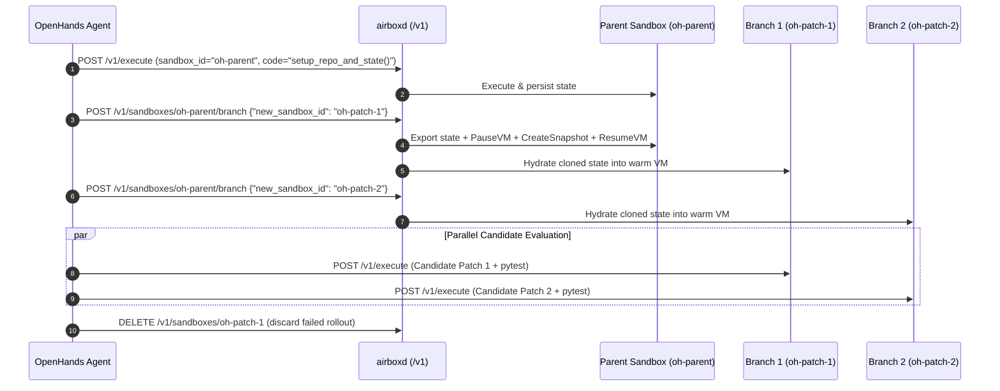

# OpenHands Runtime Integration & MCTS Branching Specification

This document specifies how **[OpenHands](https://github.com/All-Hands-AI/OpenHands)** (formerly OpenDevin) integrates with **FastVM (`airboxd`)** via the [`FastVMRuntime`](../integrations/openhands/fastvm_runtime.py) adapter (`integrations/openhands/`).

---

## 1. Action-to-API Mapping Specification

OpenHands agents emit typed `Action` events and expect typed `Observation` events. `FastVMRuntime` maps each OpenHands action directly to `airboxd` REST endpoints bound to a pinned `sandbox_id`:

| OpenHands Method / Action | `airboxd` HTTP Endpoint | Execution Language | Return Observation / Output |
| :--- | :--- | :--- | :--- |
| `connect()` / `connect_sync()` | `POST /v1/execute` | `"python"` (`pass`) | Acquires a warm Firecracker microVM and pins `sandbox_id` in `SandboxManager.pinnedInstances` |
| `run(CmdRunAction)` | `POST /v1/execute` | `"bash"` | `CmdOutputObservation(content, command, exit_code)` |
| `run_ipython(IPythonRunCellAction)` | `POST /v1/execute` | `"python"` | `IPythonRunCellObservation(content, code)` (persists variables & functions in `/tmp/airbox_py_state.pkl`) |
| `read(FileReadAction)` | `POST /v1/execute` | `"python"` (`pathlib.Path.read_text`) | `FileReadObservation(content, path)` or `ErrorObservation` |
| `write(FileWriteAction)` | `POST /v1/execute` | `"python"` (`base64` $\rightarrow$ `write_bytes`) | `FileWriteObservation(content="", path)` or `ErrorObservation` |
| `branch(new_sandbox_id)` | `POST /v1/sandboxes/{id}/branch` | N/A (Snapshot + Hydrate) | New `FastVMRuntime` bound to the forked `sandbox_id` |
| `start_job(code, language)` | `POST /v1/jobs` | `"python"` / `"bash"` | `JobInfo` (`HTTP 202 Accepted` in `<1ms`) |
| `close()` | `DELETE /v1/sandboxes/{id}` | N/A | Releases TAP device, removes `/dev/shm` overlay, and returns VM to `warmPool` |

---

## 2. Multi-Language Stateful Session Specification

An OpenHands coding session interleaves `IPythonRunCellAction` (`"python"`) and `CmdRunAction` (`"bash"`) against the **same** `sandbox_id`.

### Wire Protocol (`POST /v1/execute`)
```json
{
  "sandbox_id": "oh-a1b2c3d4",
  "language": "python",
  "code": "dataset = [10, 20, 30, 40]\ndef compute_metric(items):\n    return sum(items) / len(items)",
  "timeout_ms": 30000
}
```

### In-Guest State Persistence Rules (`cmd/agent-init/main.go` & `pkg/sandbox/mock.go`)
1. **Instance Pinning**: Any `/v1/execute` call with a non-empty `sandbox_id` pins the backing `Instance` in `SandboxManager.pinnedInstances[sandbox_id]`.
2. **Per-Request Language Routing (`ExecuteLang`)**: Subsequent requests to the same `sandbox_id` dynamically switch between the warm in-guest Python worker (`"python"`) and `/bin/bash -c` (`"bash"`) inside the same rootfs overlay.
3. **Variable & Function Serialization**:
   - Standard picklable objects (`int`, `float`, `str`, `list`, `dict`, `set`) are serialized directly via `pickle.dumps`.
   - User-defined functions (`types.FunctionType`) are serialized as `("__airbox_func__", marshal.dumps(fn.__code__), fn.__name__, fn.__defaults__)` and reconstructed into the active namespace on subsequent calls and across `branch()` forks.

---

## 3. Speculative State Branching Specification (MCTS / Tree-of-Thoughts)

Tree-of-Thoughts and Monte Carlo Tree Search (MCTS) coding agents evaluate $N$ candidate patches from a common state. Instead of mutating a single container and running `git reset --hard`, `FastVMRuntime.branch()` forks the live sandbox into $N$ isolated sandboxes.



### Branch Endpoint Contract
* **Request:** `POST /v1/sandboxes/{parent_id}/branch`
  ```json
  {
    "new_sandbox_id": "oh-branch-patch-1"
  }
  ```
* **Response (`200 OK`):**
  ```json
  {
    "parent_sandbox_id": "oh-parent",
    "sandbox_id": "oh-branch-patch-1",
    "driver": "firecracker",
    "snapshot_path": "/dev/shm/airbox-overlays/snap-oh-branch-patch-1.vmstate",
    "memory_path": "/dev/shm/airbox-overlays/snap-oh-branch-patch-1.mem",
    "duration_ms": 4
  }
  ```
* **Isolation Guarantee**: Mutations to Python globals, functions, or files inside `oh-branch-patch-1` do not affect `oh-parent` or sibling branches.

---

## 4. Sandbox Teardown Contract (`DELETE /v1/sandboxes/{id}`)

When an OpenHands session or MCTS rollout branch finishes, calling `runtime.close()` issues:
* **Request:** `DELETE /v1/sandboxes/{id}`
* **Response (`200 OK`):**
  ```json
  {
    "sandbox_id": "oh-branch-patch-1",
    "status": "terminated"
  }
  ```
* **Server Action (`SandboxManager.DestroySandbox`)**:
  1. Removes `id` from `sandboxes`, `pinnedInstances`, and `recentInstances`.
  2. Releases the allocated `/30` TAP interface back to `NetlinkPool`.
  3. Deletes `/dev/shm/airbox-overlays/rootfs-<id>.ext4`.
  4. Stops or recycles the underlying microVM instance.

---

## 5. Verification & Usage

* **Automated Go + Python Test Suite:**
  ```bash
  go test -v -race ./tests/unit -run "TestOpenHands"
  ```
* **Standalone MCTS Branching Demo:**
  ```bash
  python3 integrations/openhands/examples/mcts_branching_demo.py --url http://localhost:8080
  ```
