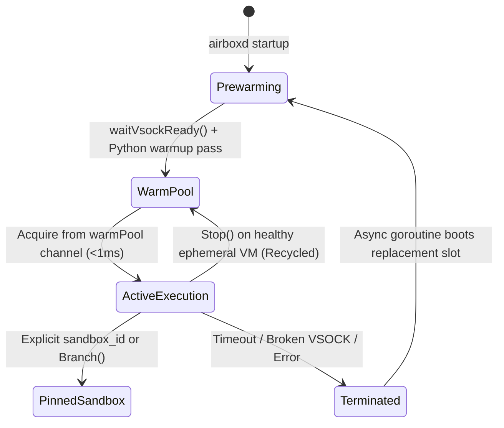
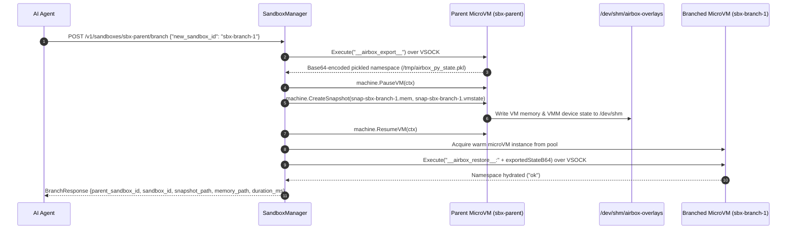

# Sandbox Lifecycle, Warm Pooling & State Branching

FastVM supports three execution paradigms required by modern autonomous coding agents:
1. **Ephemeral One-Shot Execution**: Run untrusted code in a fresh environment and recycle immediately.
2. **Stateful / Pinned Sessions & Speculative Branching**: Maintain state across multi-turn agent steps and fork (`branch`) a sandbox into parallel copy-on-write trajectories.
3. **Asynchronous Background Jobs**: Dispatch long-running test suites or builds in `<1ms` (`HTTP 202 Accepted`) and poll or cancel them out-of-band.

---

## 1. Pre-Warmed Firecracker Pool (`warmPool`)

At daemon startup (`cmd/airboxd/main.go`), `SandboxManager` calls `FirecrackerHypervisor.Prewarm` (`pkg/sandbox/firecracker_linux.go`) to boot `--warm-pool-size` (default `10`) microVMs in parallel.



### Warm Slot Boot Sequence (`bootWarmSlot`)
For each slot in the warm pool:
1. Acquires a dedicated TAP interface (`tap0`..`tapN`) from the `NetlinkPool`.
2. Materializes a sparse/reflink copy of `rootfs.ext4` in `/dev/shm/airbox-overlays/rootfs-fc-slot-<slot>-<seq>.ext4`.
3. Spawns the `firecracker` VMM with `1 vCPU` and `128 MiB` RAM.
4. Calls `waitVsockReady(5 * time.Second)`, which polls the host VSOCK UNIX socket every `10ms`, performs `CONNECT 5000\n`, and runs a warm-up payload (`{"language": "python", "code": "pass"}`) so the guest's Python interpreter is completely initialized before the VM enters `warmPool`.

### Self-Healing Pool Replenishment
When an ephemeral execution completes (`FirecrackerInstance.Stop()`):
* **Healthy Instance (`!inst.broken`)**: Returned directly to `h.warmPool` for immediate reuse.
* **Broken or Timed-Out Instance (`inst.broken`)**: If an execution times out, crashes the VSOCK connection, or errors out, the instance is marked `broken = true`. `Stop()` terminates the tainted VMM (`StopVMM()`), deletes its `/dev/shm` overlay, and spawns a background goroutine (`go hyp.bootWarmSlot(...)`) to replenish the pool without blocking the caller.

---

## 2. Ephemeral Copy-on-Write Storage (`pkg/storage/overlay.go`)

Disk I/O is a frequent hidden bottleneck in microVM sandboxes. FastVM avoids physical disk bottlenecks by placing all per-sandbox root filesystems and VM snapshots in **`/dev/shm/airbox-overlays`** (an in-memory `tmpfs` mount on Linux).

When a new rootfs overlay is needed (`storage.MaterializeOverlay`), FastVM executes:
```bash
cp --sparse=always --reflink=auto <baseRootfsPath> <overlayPath>
```
* `--reflink=auto` performs an instant copy-on-write clone on filesystems that support reflinks (XFS, Btrfs).
* `--sparse=always` skips zero-blocks when copying into `/dev/shm` (`tmpfs`), keeping memory footprint proportional only to actual non-zero data blocks.

---

## 3. Stateful Sandboxes & Speculative Branching (`POST /v1/sandboxes/{id}/branch`)

AI coding agents frequently explore multiple candidate solutions (e.g., Tree-of-Thoughts, MCTS, or trying two different library patches). Instead of re-running all setup steps from scratch, an agent can **branch** a live sandbox.

### How Stateful Pinning Works
In `SandboxManager.Execute` (`pkg/sandbox/manager.go`):
* If the client omits `sandbox_id`, a random `sbx-<uuid>` is generated, executed once, and stopped/returned to the pool via `defer`.
* If the client provides an explicit `sandbox_id` (or calls `Branch`), the instance is stored in `m.pinnedInstances[sandboxID]`. The `defer` block skips calling `inst.Stop()`, keeping the microVM and its in-guest Python state alive for subsequent requests targeting that `sandbox_id`.

### How Branching Works (`FirecrackerInstance.Branch`)



1. **Export In-Guest State**: Queries the parent VM with `__airbox_export__` to retrieve a base64 representation of `/tmp/airbox_py_state.pkl`.
2. **Pause Parent VM**: Calls Firecracker's `PauseVM` API to freeze guest vCPUs cleanly.
3. **Snapshot Memory & Device State**: Calls `CreateSnapshot` to dump guest physical memory (`snap-<newID>.mem`) and microVM device state (`snap-<newID>.vmstate`) into `/dev/shm/airbox-overlays`.
4. **Resume Parent Immediately**: Calls `ResumeVM` so the parent sandbox remains usable without interruption.
5. **Hydrate Child Branch**: Acquires a warm microVM instance for `newID`, injects the exported state via `__airbox_restore__:<base64>`, and pins both `parentID` and `newID` in `SandboxManager.pinnedInstances`. Both sandboxes can now be mutated independently.

---

## 4. Asynchronous Background Jobs (`/v1/jobs`)

For longer agent tasks (such as running a test suite or compiling code), blocking an HTTP request is undesirable. Clients can either pass `"async": true` to `POST /v1/execute` or call `POST /v1/jobs` directly.

* **Sub-Millisecond Dispatch (`SandboxManager.StartJob`)**:
  Generates a `job-<uuid>` and `sbx-<uuid>`, registers a cancellable `context.Context` in `m.jobCancels[jobID]`, spawns a background goroutine running `m.Execute(jobCtx, req)` (with a 60-second default timeout), and immediately returns `HTTP 202 Accepted`.
* **Job Lifecycle States**:
  - `running` $\rightarrow$ Initial state while the background goroutine executes inside the microVM.
  - `completed` $\rightarrow$ Exited with `exit_code == 0` and `!is_timeout`.
  - `failed` $\rightarrow$ Exited with non-zero `exit_code` or hypervisor error.
  - `timeout` $\rightarrow$ Exceeded `timeout_ms` (`is_timeout == true`).
  - `cancelled` $\rightarrow$ Terminated early via `DELETE /v1/jobs/{id}`, which invokes the stored `context.CancelFunc`.
