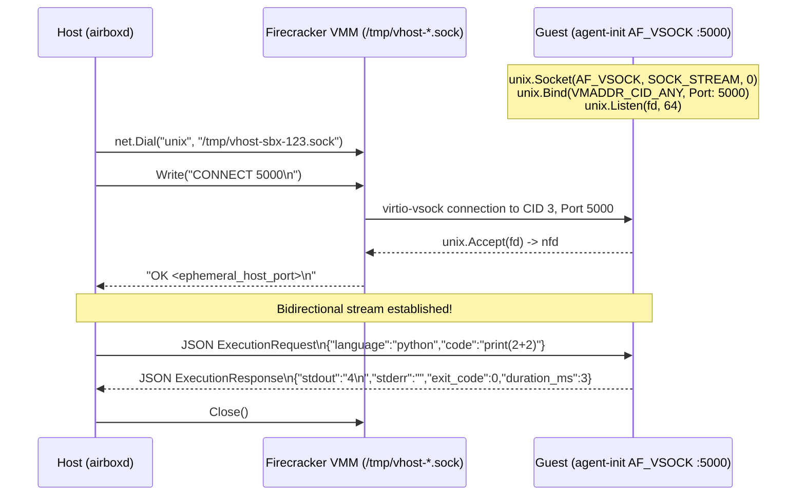
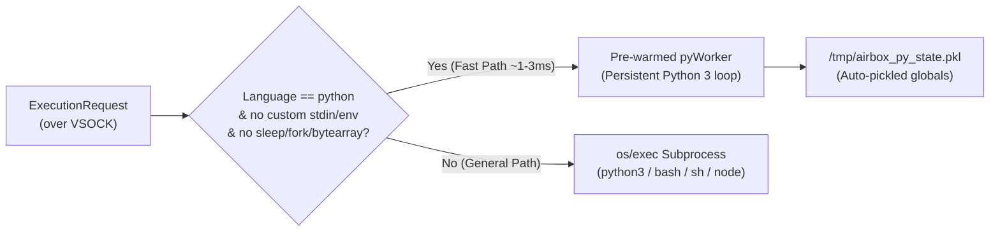

# VSOCK & In-Guest Agent (`agent-init`)

Inside every Firecracker microVM, FastVM boots directly into a custom static Go binary located at `/sbin/agent-init` (`cmd/agent-init`). Skipping `systemd` or OpenRC eliminates hundreds of milliseconds of guest OS userspace initialization.

---

## 1. Booting as Guest `PID 1`

Firecracker boots the guest Linux kernel (`vmlinux`) with custom kernel command-line parameters configured in `pkg/sandbox/firecracker_linux.go`:

```text
quiet loglevel=0 8250.nr_uarts=0 noapic reboot=k panic=1 pci=off i8042.noaux i8042.nomux i8042.nopnp i8042.dumbkbd random.trust_cpu=on init=/sbin/agent-init airbox_ip=172.16.0.2/30 airbox_gw=172.16.0.1
```

* **`quiet loglevel=0 8250.nr_uarts=0`**: Disables serial console printing during kernel boot, which is a well-known microVM boot bottleneck (serial UART emulation causes expensive VM exits on every printed character).
* **`pci=off i8042.*`**: Skips legacy PCI bus enumeration and PS/2 keyboard controller probing.
* **`init=/sbin/agent-init`**: Instructs the kernel to execute `/sbin/agent-init` directly as `PID 1`.

### Early Filesystem & Kernel Hardening (`mountInitFilesystems`)
When `agent-init` starts on Linux (`cmd/agent-init/vsock_linux.go`) and detects `os.Getpid() == 1`, it immediately:
1. Mounts virtual filesystems required by language runtimes:
   - `proc` $\rightarrow$ `/proc`
   - `sysfs` $\rightarrow$ `/sys`
   - `devtmpfs` $\rightarrow$ `/dev`
   - `tmpfs` $\rightarrow$ `/tmp`
2. Protects itself (`PID 1`) from the Linux kernel OOM-killer by writing `-1000` to `/proc/1/oom_score_adj`.
3. Caps maximum kernel threads inside the guest by writing `128` to `/proc/sys/kernel/threads-max`.

---

## 2. What is `AF_VSOCK` (`virtio-vsock`)?

**VSOCK** (Virtual Socket, address family `AF_VSOCK`) is a Linux socket family built for hypervisor-to-guest communication.

### Why `AF_VSOCK` Instead of Network Sockets (`AF_INET`)?
1. **Zero Network Stack Overhead**: Communication occurs over a shared-memory virtio ring buffer (`virtio-vsock`) between the Firecracker VMM on the host and the guest kernel, bypassing Ethernet framing, ARP, IP routing, TCP three-way handshakes, and `iptables`.
2. **Immediate Readiness**: `agent-init` opens the `AF_VSOCK` listener on port `5000` *before* configuring `eth0`, allowing the host to health-check and warm up the guest immediately.
3. **Decoupled from Sandbox Network Policy**: Even if a sandbox's network card is torn down or blocked by firewall rules, the host control plane retains full command-and-control over the microVM.

---

## 3. Host $\leftrightarrow$ Guest Connection & Handshake Protocol

Firecracker bridges the guest's `AF_VSOCK` device to the host OS via a host-side **UNIX domain socket** (`/tmp/vhost-<sandboxID>.sock`).



### Guest-Side Implementation (`cmd/agent-init/vsock_linux.go`)
Because Go's standard `net` package does not natively include an `AF_VSOCK` dialer/listener, `agent-init` uses `golang.org/x/sys/unix` syscalls directly:
* Calls `unix.Socket(unix.AF_VSOCK, unix.SOCK_STREAM, 0)`.
* Binds to `&unix.SockaddrVM{CID: unix.VMADDR_CID_ANY, Port: 5000}`.
* Accepts incoming file descriptors via `unix.Accept(fd)` and wraps each descriptor in a lightweight `vsockConn` struct implementing `net.Conn` (`Read`, `Write`, `Close`).

### Host-Side Implementation (`pkg/sandbox/firecracker_linux.go`)
* Attaches a `firecracker.VsockDevice` with `CID: 3` and `Path: "/tmp/vhost-<sandboxID>.sock"`.
* Dials the UNIX socket, sends `"CONNECT 5000\n"`, and verifies that the response line starts with `"OK "`.
* Once `"OK "` is received, the UNIX socket acts as a raw byte stream connected directly to `handleConnection` inside the guest.

---

## 4. In-Guest Execution Engine (`pyWorker` vs. Subprocess)

When `agent-init` receives an `ExecutionRequest` over VSOCK, it chooses between two execution paths in `runPayload` (`cmd/agent-init/main.go`):



### 1. Fast Path: Pre-Warmed `pyWorker`
Spawning a fresh `/usr/bin/python3` process costs `~25ms–50ms` just to initialize the Python interpreter and import site packages. To avoid paying this cost on every request:
* `agent-init` starts a persistent background `python3 -u -c pyLoopScript` worker (`guestPyWorker`) when the microVM boots.
* `pyWorker` reads single-line JSON payloads from its `stdin`, executes the code via `exec(compile(code, "<sandbox>", "exec"), ns)` while capturing `stdout` and `stderr` with `contextlib.redirect_stdout`/`redirect_stderr`, and writes a single-line JSON result to `stdout`.
* After each execution, picklable variables in the global namespace `ns` are persisted to `/tmp/airbox_py_state.pkl`.
* Special internal commands (`__airbox_export__` and `__airbox_restore__:<base64>`) allow the host to extract or hydrate the pickled Python namespace during sandbox branching.

### 2. General Path: Isolated Subprocess (`os/exec`)
For `bash`, `sh`, `node`/`javascript`, or Python payloads that use custom `stdin`, custom `env`, or potentially hazardous operations (`sleep`, `fork`, `bytearray`), `agent-init` spawns a dedicated child process:
* For Python subprocesses, it enforces a per-invocation process limit (`ulimit -u 32`) before invoking `exec python3 -c "$AIRBOX_CODE"`.
* If the child process is killed by a signal (such as `SIGKILL` from the guest OOM-killer), `agent-init` normalizes the exit code to `137` (`128 + 9`).
